# Homelab

<!-- BROUILLON : les éléments à compléter sont marqués TODO(khalil) -->

Une stack de supervision auto-hébergée sur une seule machine Linux, déployée avec **une seule commande Ansible**. Elle fait tourner Traefik (reverse proxy + TLS local), Prometheus, Grafana et Uptime Kuma dans Docker. Chaque service a son propre nom d'hôte HTTPS sous `*.homelab.lab`.

<!-- TODO(khalil): captures d'écran : dashboard Grafana « Node Exporter Full » + page de statut Uptime Kuma -->
<!--  -->

## Stack

| Service | Rôle | URL | Image |
|---|---|---|---|
| Traefik | Reverse proxy, redirection HTTP→HTTPS, terminaison TLS, dashboard | https://traefik.homelab.lab | `traefik:v3.6.1` |
| Prometheus | Collecte des métriques (scrape toutes les 15 s) | https://prometheus.homelab.lab | `prom/prometheus` |
| Node Exporter | Métriques de la machine (CPU, RAM, disque, réseau) | — (interne, `:9100`) | `prom/node-exporter` |
| Grafana | Dashboards ; datasource et dashboard provisionnés en tant que code | https://grafana.homelab.lab | `grafana/grafana` |
| Uptime Kuma | Surveillance de disponibilité des autres services | https://kuma.homelab.lab | `louislam/uptime-kuma:1` |
| Ansible | Démarre toute la stack dans le bon ordre (`site.yml`) | — | `ansible-core ~2.21` |

## Architecture



Comment ça s'articule :

- **Routage par labels.** Traefik lit le socket Docker. Il n'expose que les conteneurs qui ont `traefik.enable=true` (`exposedByDefault: false`). Chaque service déclare sa propre règle `Host(...)` dans les labels de son `docker-compose.yml`, donc ajouter un service ne demande pas de toucher à la config de Traefik.
- **Un réseau partagé entre projets Compose.** Traefik, la supervision et Kuma sont trois projets Compose séparés. Ils se rejoignent sur un réseau externe, `shared-net`, qu'Ansible crée en premier. Node Exporter reste sur le réseau par défaut du projet de supervision : seul Prometheus peut le joindre par son nom.
- **TLS local.** `install.sh` utilise [mkcert](https://github.com/FiloSottile/mkcert) pour générer un certificat wildcard pour `*.homelab.lab`. Traefik le charge comme certificat par défaut via le provider fichier (`traefik/dynamic/tls.yml`). Le port 80 redirige vers le 443.
- **Grafana en tant que code.** La datasource Prometheus et le dashboard *Node Exporter Full* (ID grafana.com 1860) sont provisionnés depuis `monitoring/grafana/provisioning/`. Un Grafana neuf démarre avec un dashboard fonctionnel, sans aucun clic.
- **Uptime Kuma vérifie les vraies URLs.** `extra_hosts` fait pointer `*.homelab.lab` vers la passerelle de l'hôte, donc Kuma vérifie les services en passant par Traefik, exactement comme un navigateur.

## Structure du dépôt

```
.
├── install.sh                  # outillage local au projet : venv, Ansible, collections, certificat TLS
├── ansible/
│   ├── ansible.cfg             # inventaire + chemin local des collections
│   ├── hosts.yml               # une seule machine, connexion locale
│   ├── requirements.yml        # community.docker
│   └── site.yml                # réseau → traefik → supervision → kuma
├── traefik/
│   ├── docker-compose.yml
│   ├── traefik.yml             # config statique : entrypoints, providers, dashboard
│   ├── dynamic/tls.yml         # config dynamique : certificat
│   └── certs/                  # généré par install.sh (ignoré par git)
└── monitoring/
    ├── docker-compose.yml      # node-exporter, prometheus, grafana
    ├── prometheus.yml
    ├── grafana/provisioning/   # datasource + dashboards
    └── kuma/docker-compose.yml
```

## Démarrage

### Prérequis (une seule fois, au niveau système)

`install.sh` n'installe aucun paquet système et n'utilise pas `sudo`. Faites donc ces étapes vous-même d'abord :

1. **Docker** avec le plugin Compose, démarré et utilisable par votre utilisateur.
2. **mkcert** et **nss** (pour que Firefox/Chromium fassent confiance à l'autorité de certification), puis lancez une fois :
   ```bash
   mkcert -install
   ```
3. **Python 3** (avec `venv`).
4. **DNS** : les noms d'hôte doivent pointer vers la machine. Le plus rapide est `/etc/hosts` :
   ```
   127.0.0.1  traefik.homelab.lab grafana.homelab.lab prometheus.homelab.lab kuma.homelab.lab
   ```

### Installation et déploiement

```bash
git clone https://github.com/Khalil-bec/Homelab.git
cd Homelab
./install.sh                     # crée .venv, installe Ansible + community.docker, génère le certificat

source .venv/bin/activate
cd ansible
ansible-playbook site.yml        # crée shared-net, puis démarre traefik, la supervision et kuma
```

Le playbook est idempotent : vous pouvez le relancer à tout moment. Une fois terminé, ouvrez https://grafana.homelab.lab.

<!-- TODO(khalil): première connexion Grafana : admin/admin par défaut, ou préciser comment vous l'avez configuré -->

### Arrêt

```bash
docker compose -f monitoring/kuma/docker-compose.yml down
docker compose -f monitoring/docker-compose.yml down
docker compose -f traefik/docker-compose.yml down
docker network rm shared-net
```

Ajoutez `-v` aux commandes `down` pour supprimer aussi les volumes de données (Prometheus, Grafana et Kuma).

## Choix techniques

- **Ansible en connexion `local`.** Tout tourne sur une seule machine, donc pas de SSH ni d'inventaire distant. Le playbook fixe l'ordre de démarrage (le réseau doit exister avant les projets Compose qui l'utilisent).
- **Outillage local au projet.** Ansible est épinglé dans `.venv/` et les collections sont dans `.collections/`. Rien ne va dans `~/.ansible` ni dans le Python système : l'installation est reproductible et facile à supprimer.
- **Les secrets restent hors de git.** Les certificats générés, les fichiers `.env`, le mot de passe du vault et le venv sont ignorés par git.
